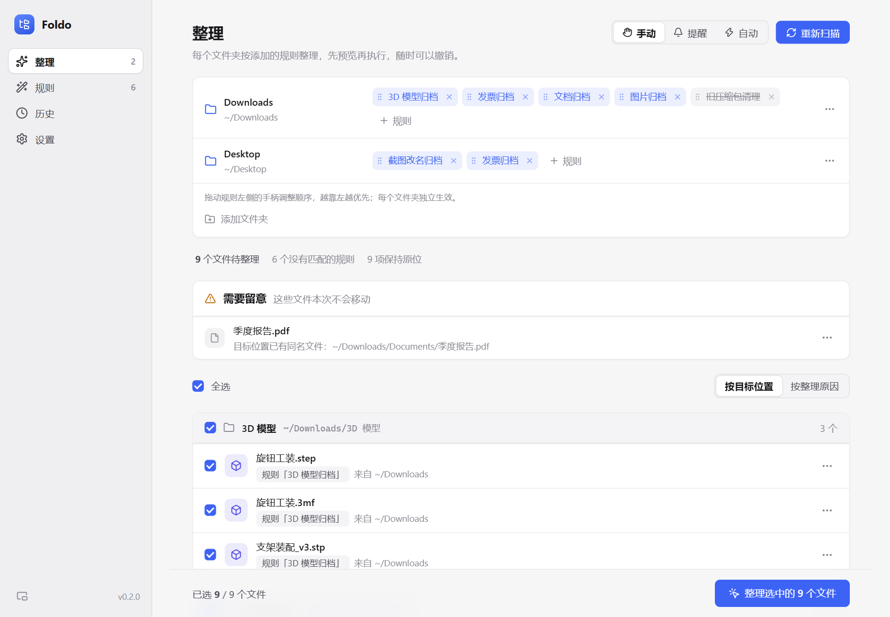
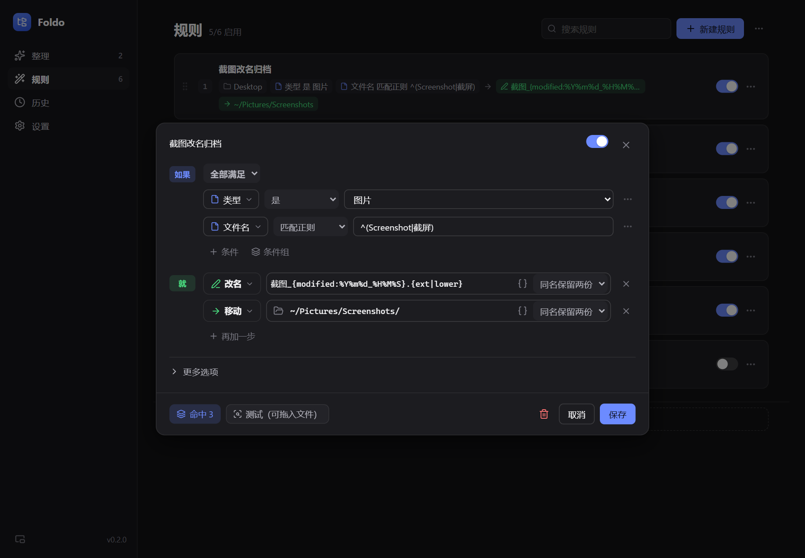
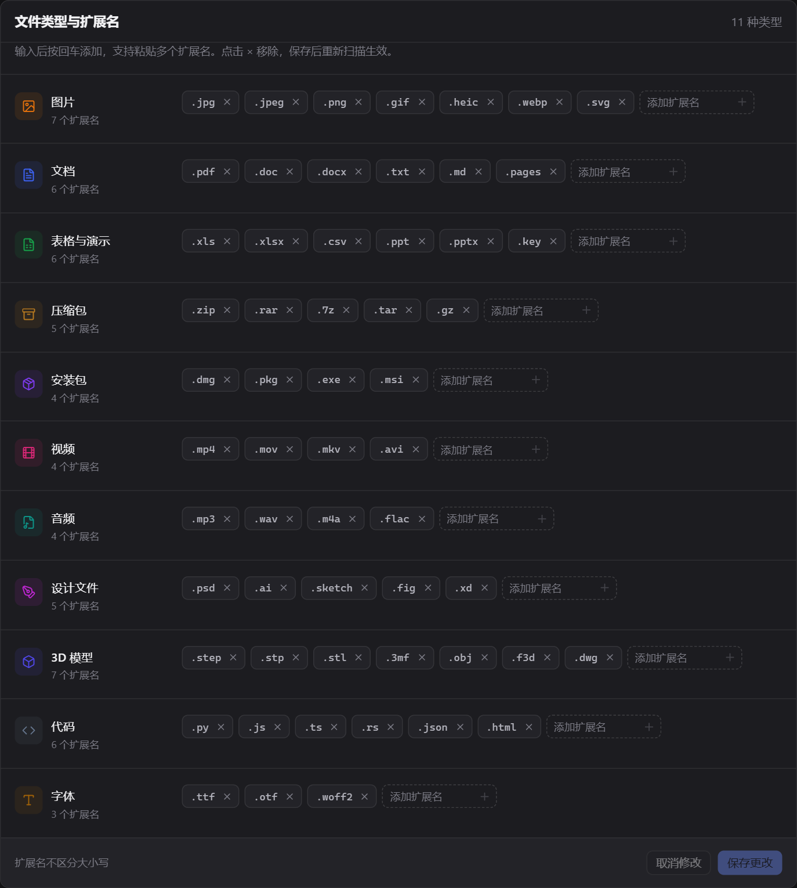

<div align="center">
  
  <h1>Foldo</h1>
  <p><strong>Your files. Your rules. A tidier folder.</strong></p>
  <p>A local-first folder organizer for Windows, macOS and Linux.<br />Preview every change, organize with rules, and undo when you need to.</p>
  <p><strong>English</strong> · <a href="README.zh-CN.md">简体中文</a></p>
  <p><a href="https://github.com/Wonvy/Foldo/releases/latest">Download</a> · <a href="#a-quick-tour">Screenshots</a> · <a href="#get-started">Get started</a> · <a href="https://github.com/Wonvy/Foldo/issues">Report an issue</a></p>
  <p><a href="https://github.com/Wonvy/Foldo/actions/workflows/build.yml"></a> <a href="https://github.com/Wonvy/Foldo/releases"></a> </p>
</div>



## Download

Installers are attached to **[GitHub Releases](https://github.com/Wonvy/Foldo/releases/latest)** under **Assets**. Choose a desktop installer, not the automatically generated source-code archives.

| Platform | Desktop download | Updating |
| --- | --- | --- |
| Windows 10 / 11 · x64 | [Setup installer](https://github.com/Wonvy/Foldo/releases/download/v0.2.0/foldo-desktop-v0.2.0-windows-x64-setup.exe) | In-app download and install |
| macOS · Apple Silicon | [DMG installer](https://github.com/Wonvy/Foldo/releases/download/v0.2.0/foldo-desktop-v0.2.0-macos-arm64.dmg) | In-app download and install |
| Linux · x64 | [AppImage](https://github.com/Wonvy/Foldo/releases/download/v0.2.0/foldo-desktop-v0.2.0-linux-x64.AppImage) · [Debian package](https://github.com/Wonvy/Foldo/releases/download/v0.2.0/foldo-desktop-v0.2.0-linux-x64.deb) | AppImage: in-app; `.deb`: manually install the new package |

The table links to v0.2.0. For future versions, use **[Latest release](https://github.com/Wonvy/Foldo/releases/latest)**. CLI archives are also available for Windows x64, macOS ARM64 / x64 and Linux x64. Each release includes `SHA256SUMS.txt`.

Builds are not Windows Authenticode-signed or Apple-notarized, so your OS may display a security prompt. Update packages have a separate signature verified by Foldo. The app interface is currently Chinese; this README is available in English and Chinese.

## Why Foldo?

| Feature | What it does |
| --- | --- |
| **Preview before organizing** | Inspect destinations, skipped files and conflicts before executing a plan. |
| **Rules per folder** | Attach rules and drag their handles left or right to set independent priorities. The first matching rule wins. |
| **Flexible conditions** | Match names, extensions, size, dates, image dimensions, metadata, text and duplicates (across all your folders); combine groups and exceptions. |
| **Folders, too** | Rules can target subfolders as a whole: by folder type (code project, app bundle, empty), main content type, item names and extensions inside, size or last change. |
| **Custom file types** | Add or remove extension tags for pictures, documents and other built-in types. |
| **Useful actions** | Move, copy, rename, compress, extract zip / 7z / rar / tar archives, create shortcuts, keep files or send them to the recycle bin. |
| **History and undo** | Review operations and preview what an undo can restore. |
| **Background organization** | Watch folders from the tray, choose notifications or automatic organization, or drag files onto the app. |
| **Scheduled tidy** | Tidy once a day or once a week at a set time; a run missed while the computer was off happens next time. |
| **Profiles** | Keep separate folder and rule setups, e.g. for work and personal, and switch from the Tidy page or the tray. |
| **Large folders** | Scans show progress and can be cancelled; lists with thousands of files still scroll smoothly. |
| **Local configuration** | A readable YAML file and local SQLite journal; GUI and CLI share the same engine. |
| **History** | Keep all records within the configured retention period and view monthly statistics. Only the latest run can be undone by default; Settings → Organizing allows up to 3 recent runs, undone from newest to oldest. |
| **Four languages** | English, 简体中文, 繁體中文 and 日本語. Follows the system language by default; switch in Settings. |

## A quick tour

### Build and test a rule



Set **if / then** conditions, add exceptions, and drop in a file to test the rule. Errors are displayed explicitly instead of leaving an endless spinner. Unmatched files in the organization preview are grouped by extension and start collapsed.

### Make file types your own



In **Settings → File types and extensions** (`设置 → 文件类型与扩展名`), press Enter to add a tag, paste several extensions, or click × to remove one. Save and rescan to apply the new classification.

*Screenshots show the actual development UI with demonstration data, not personal files.*

## Get started

1. Install Foldo and select a folder. Start with a test folder containing a few sample files.
2. Open **Rules** (`规则`) and create a rule, for example “type is Picture → move to Pictures”.
3. In **Organize** (`整理`), attach the rule to a folder. Drag rule handles to change that folder's matching order.
4. Scan, review the destinations, select files and organize. Use **History** (`历史`) to review or undo operations.

Files with no matching rule stay where they are. Existing folders are kept intact unless you enable recursion. Protected files, system locations, incomplete downloads and files within the buffer period are excluded. Files sent to the recycle bin must be restored there manually; undo previews explain other limitations.

Only one desktop instance runs at a time. Opening Foldo again restores the existing main window, including when it is minimized or hidden in the tray, without starting another background organizer. To fully quit, choose **Quit Foldo** from the tray menu.

## Updates

Foldo checks the latest stable GitHub Release on startup. You can also open **Settings → Version and updates** (`设置 → 版本与更新`) and click **Check for updates**. **Download and restart** downloads the signed package, verifies it and installs it. Download progress is displayed; rules and history are retained. Checking does not automatically install an update.

If GitHub is unavailable, retry later or use **GitHub Releases** to download an installer. Prereleases are excluded from the stable update feed. Debian-package users install a newer `.deb` manually.

## CLI and configuration

```sh
foldo --rules rules.yaml check    # Validate the configuration
foldo --rules rules.yaml plan     # Preview without changing files
foldo --rules rules.yaml run      # Confirm and execute
foldo history
foldo undo                       # Undo the latest batch
foldo inspect example.jpg        # Inspect file properties
```

```yaml
version: 2
folders:
  - path: ~/FoldoTest
    rules: [Pictures]
rules:
  - name: Pictures
    when: { category: Pictures }
    actions:
      - move: "Pictures/{modified:%Y}/"
```

See the [example rules](examples/rules.yaml) and [configuration reference (Chinese)](docs/configuration.zh-CN.md). `FOLDO_RULES` overrides the rules path; `FOLDO_HOME` overrides the operation-data directory. Category names accept English aliases.

## Development

Requires current stable Rust, Node.js 22.12+ (24 recommended), and the [Tauri system prerequisites](https://v2.tauri.app/start/prerequisites/).

```sh
cargo test --locked
cargo clippy --all-targets --locked -- -D warnings
cd apps/desktop
npm ci
npm run tauri dev
```

| Directory | Purpose |
| --- | --- |
| `crates/foldo-core` | Rule engine, metadata, planning, execution and undo |
| `crates/foldo-cli` | Command-line interface |
| `apps/desktop` | Tauri 2, React and TypeScript desktop app |
| `.github/workflows/build.yml` | Cross-platform checks, packaging and publishing |

**Automatic releases:** push a new synchronized application version to `main`, or push its matching `v*` tag. After checks and all packages succeed, installers, signed update packages and the update manifest are published to a Release. Existing versions are not overwritten. See [Releasing Foldo](docs/RELEASING.md).
