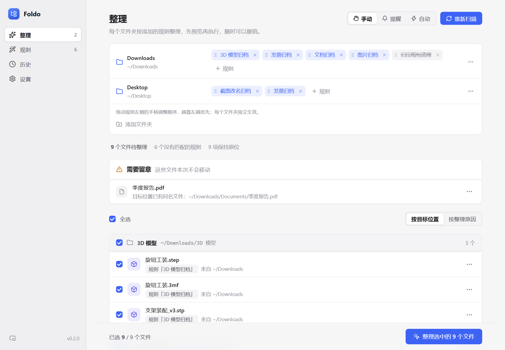
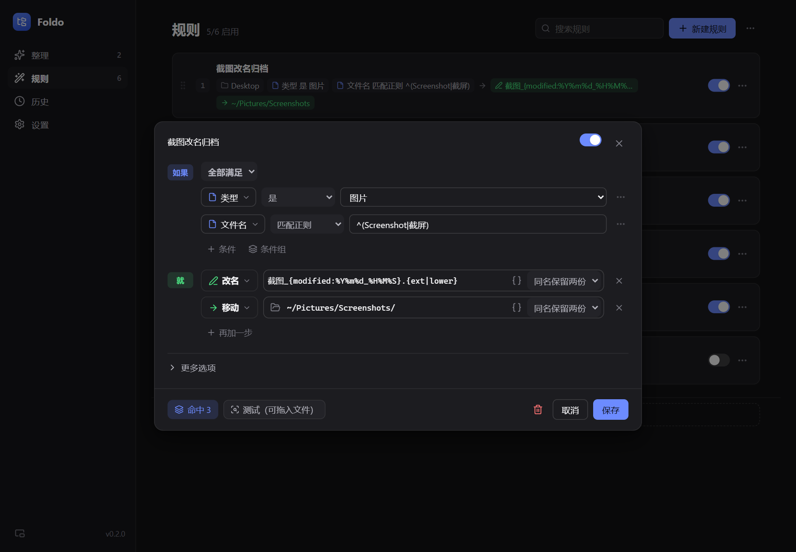
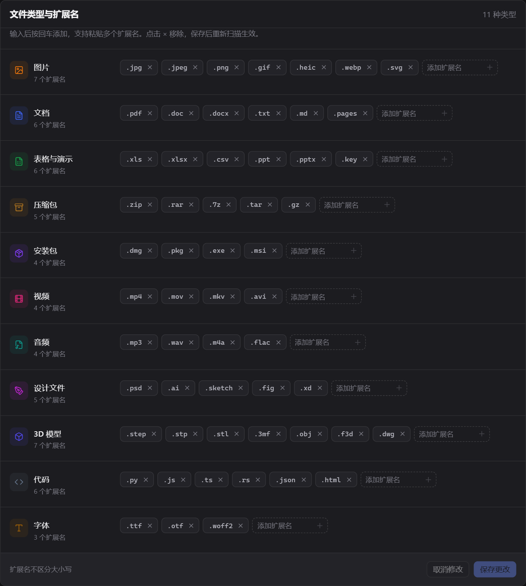

<div align="center">
  
  <h1>Foldo</h1>
  <p><strong>你的文件，你的规则，整齐的文件夹。</strong></p>
  <p>适用于 Windows、macOS 和 Linux 的本地文件整理工具。<br />先预览，再整理，需要时可以撤销。</p>
  <p><a href="README.md">English</a> · <strong>简体中文</strong></p>
  <p><a href="https://github.com/Wonvy/Foldo/releases/latest">下载安装包</a> · <a href="#界面预览">界面预览</a> · <a href="#开始使用">开始使用</a> · <a href="https://github.com/Wonvy/Foldo/issues">反馈问题</a></p>
  <p><a href="https://github.com/Wonvy/Foldo/actions/workflows/build.yml"></a> <a href="https://github.com/Wonvy/Foldo/releases"></a></p>
</div>



## 下载

安装包在 **[GitHub Releases](https://github.com/Wonvy/Foldo/releases/latest)** 的 **Assets** 中，无需登录即可下载。请选择安装包，不要下载自动生成的 Source code 源码压缩包。

| 平台 | 桌面版下载 | 更新方式 |
| --- | --- | --- |
| Windows 10 / 11 · x64 | [安装程序](https://github.com/Wonvy/Foldo/releases/download/v0.2.0/foldo-desktop-v0.2.0-windows-x64-setup.exe) | 应用内下载并安装 |
| macOS · Apple 芯片 | [DMG 安装包](https://github.com/Wonvy/Foldo/releases/download/v0.2.0/foldo-desktop-v0.2.0-macos-arm64.dmg) | 应用内下载并安装 |
| Linux · x64 | [AppImage](https://github.com/Wonvy/Foldo/releases/download/v0.2.0/foldo-desktop-v0.2.0-linux-x64.AppImage) · [Debian 安装包](https://github.com/Wonvy/Foldo/releases/download/v0.2.0/foldo-desktop-v0.2.0-linux-x64.deb) | AppImage 支持应用内更新，`.deb` 手动安装新版 |

上表直达 v0.2.0，后续版本请查看 **[最新发布](https://github.com/Wonvy/Foldo/releases/latest)**。同一页面也提供 Windows x64、macOS ARM64 / x64 和 Linux x64 命令行版，以及 `SHA256SUMS.txt` 校验文件。

安装程序尚未配置 Windows 代码签名或 Apple 公证，系统可能显示安全提示。自动更新包另有独立的加密签名，安装前由 Foldo 校验。软件界面目前为中文；本说明支持中英文切换，仓库首页默认英文。

## 功能

| 功能 | 说明 |
| --- | --- |
| **预览后执行** | 先查看目标位置、跳过原因和冲突，再决定整理哪些文件。 |
| **每个文件夹独立排序** | 添加已有规则，左右拖动手柄调整优先级，第一条命中的生效。 |
| **灵活的匹配条件** | 文件名、扩展名、大小、时间、图片尺寸、元数据、文本和重复文件（跨文件夹判断），支持条件组与例外。 |
| **文件夹分类** | 规则也能整体处理子文件夹：按文件夹类型（代码工程、应用程序、空文件夹）、内容类型、里面的项目名和扩展名、大小或最近改动判断。 |
| **自定义文件类型** | 用标签增删默认类型的扩展名，也能恢复默认。 |
| **多种动作** | 移动、复制、改名、压缩、解压 zip / 7z / rar / tar、创建快捷方式、保持原位或移入回收站。 |
| **历史与撤销** | 记录操作，撤销前展示可以恢复的内容与限制。 |
| **后台整理** | 托盘监听文件夹，可选择提醒或自动整理，也支持拖入文件。 |
| **定时整理** | 每天或每周固定时间整理一次；关机错过的时间点下次打开时补上。 |
| **配置方案** | 为“工作”“个人”等场景各存一套文件夹和规则，在整理页或托盘里一键切换。 |
| **大文件夹** | 扫描时显示进度、可以随时取消；几千个文件的列表也能流畅滚动。 |
| **本地配置** | YAML 规则和本地 SQLite 日志，桌面版与命令行版共用核心引擎。 |
| **历史记录** | 每次整理都能撤销；超过一年（可设置）的记录自动清理；历史页显示本月整理统计。 |
| **四种语言** | 简体中文、English、繁體中文、日本語；默认跟随系统语言，可在设置中切换。 |

## 界面预览

### 规则编辑与测试



用“如果…就…”建立规则，添加例外，拖入文件测试。测试失败会显示原因。没有匹配规则的文件按扩展名分组，默认折叠。

### 扩展名标签



在 **设置 → 文件类型与扩展名** 中，输入后回车添加、粘贴多个后缀，或点击 × 移除。保存后重新扫描即可使用新分类。

*截图来自实际开发界面，使用演示数据，不包含个人文件。*

## 开始使用

1. 安装并选择文件夹，建议先使用放有少量示例文件的测试目录。
2. 在“规则”页新建规则，例如“类型是图片 → 移动到 Pictures”。
3. 回到“整理”页，把规则添加到文件夹，拖动左侧手柄调整顺序。
4. 扫描、检查目标位置、选择文件并整理。需要时到“历史”查看或撤销。

没有规则命中的文件保持原位。默认不拆分已有文件夹，开启递归后才处理子文件夹。固定保留、系统目录、下载中的文件和缓冲期内的新文件会被排除。移入回收站的文件需到系统回收站手动还原，其他撤销限制会在预览中说明。

## 检查更新

启动时会检查 GitHub 最新正式版，也可以在 **设置 → 版本与更新 → 检查更新** 手动检查。发现新版本后点击 **下载并重启**，应用显示进度、校验签名并安装，保留规则和历史。检查不会自动下载安装，预发布版本不会推送给正式版用户。

网络异常时可以重试，或点击 **GitHub Releases** 手动下载安装包。通过 `.deb` 安装的 Linux 用户需手动安装新版，AppImage 支持应用内更新。

## 配置与命令行

```sh
foldo --rules rules.yaml check    # 校验配置
foldo --rules rules.yaml plan     # 预览，不改动文件
foldo --rules rules.yaml run      # 确认后执行
foldo history
foldo undo                       # 撤销最近一批操作
foldo inspect example.jpg        # 查看文件属性
```

[完整配置参考](docs/configuration.zh-CN.md) · [示例规则](examples/rules.yaml)

可用 `FOLDO_RULES` 指定规则文件、`FOLDO_HOME` 指定操作数据目录。

## 开发与发布

需要当前稳定版 Rust、Node.js 22.12 以上（推荐 24）和 [Tauri 系统依赖](https://v2.tauri.app/start/prerequisites/)。

```sh
cargo test --locked
cargo clippy --all-targets --locked -- -D warnings
cd apps/desktop
npm ci
npm run tauri dev
```

更新并统一应用版本号后推送到 `main`，或推送对应的 `v*` 标签，自动测试、打包并发布 Release。安装包、签名更新包和更新清单全部成功后才公开发布，已有正式版本不会被覆盖。详见 [发布维护说明](docs/RELEASING.md)。
